# UI-V2-I01 — B1 Enterprise Blue Vue 3 Conversion: Implementation Report

**Status:** IMPLEMENTED ON BRANCH — awaiting Product Owner review. Not merged, not deployed.
**Date:** 2026-11-01
**Branch:** `feature/ui-v2-i01-b1-vue-conversion`
**Base:** `main` @ `9b9bf5bad7733ecb7eef8e7a8d9cf60ef2fcb3b3` (latest verified `origin/main`)
**Design source:** PR #11, branch `design/uiux-v2-b1-representative-prototypes-20261101` (`docs/ui-ux-v2/prototypes/b1/*`), screen inventory PR #10.
**Scope:** UX-01 `/ai`, UX-02 `/documents`, UX-04 `/review` + shared B1 shell/design-system pieces they use. Frontend only.

## 1. Contract statement

- **Backend, API, database and security contracts are unchanged.** No file outside `src/frontend/` and this `docs/` folder is modified.
- `src/frontend/src/api/**`, `src/frontend/src/router/**` and `src/frontend/src/stores/**` are **unchanged**: same API client functions and signatures, same route paths, route names, `meta` and role guards, same session/token handling.
- No new dependency was added to `package.json`. No mock or prototype data is used in production components; `prototype.js` simulation logic was not copied.
- No platform/tenant identity boundary change: the sidebar shows the current session's tenant code as **read-only text** (the prototype's tenant picker/chevron was intentionally not implemented).
- All requests observed during visual verification (via interception) were to existing endpoints only: `GET /documents[?status=…|keyword=…|folderId=…]`, `GET /documents/{id}`, `GET /folders/tree`, `POST /ai/ask` (plus, in tests, `POST /ai/interactions/{id}/feedback`, `POST /documents/{id}/approve|reject`, download and wiki-draft calls through the existing client functions).

## 2. What changed

### 2.1 Design system (shared)

| Area | Change |
| --- | --- |
| `assets/main.css` | B1 tokens mapped onto the existing token names (`--primary` `#3159E9`, `--foreground` `#1B2941`, `--border` `#E3E9F3`, `--input` `#DCE4F0`, …) plus new tokens `--primary-hover`, `--primary-soft(-foreground)`, `--sidebar`, `--surface`, `--overlay`. Dark theme reconciled (blue hue, same structure). `--radius` → 11px so buttons/inputs get B1's 9px and cards 12px. `animate-shimmer` utility (respects `prefers-reduced-motion`). |
| `ui/button` | Default hover uses B1 hover blue; semibold text; new `subtle` variant (B1 `.btn.subtle`). |
| `ui/badge` | New `soft` (blue) and `muted` (grey) variants. |
| `ui/dialog`, `ui/alert-dialog`, `ui/sheet` | Navy 50% overlay (B1 backdrop) on all three; 16px radius on dialog/alert-dialog; Vietnamese "Đóng" screen-reader label on dialog/sheet close buttons. |
| `StatusBadge` | B1 soft pill style; same status→label/variant mapping. |
| `EmptyState` | B1 dashed "state block" look; same props/slots. |
| `PageHeader` | Optional `eyebrow` prop. |
| `DataTable` (+ pagination) | B1 table styling; new optional props `rowKey`, `selectedRowKey` (selected row highlight + `aria-current`), `rowLabel`, `bare`, `countLabel`, `tableClass`; Space/Enter row activation only when the row itself has focus; per-column `meta.cellClass/headClass`. Existing behaviour (sorting, client paging, global filter, `rowClick`) unchanged. |
| New components | `PanelCard`, `DetailPanel`, `MetaGrid`/`MetaItem`, `InlineNotice`, `SearchInput`, `FileTypeIcon`, `AppSidebarContent`. |
| New helpers | `lib/errors.ts` (Vietnamese messages for empty-body 403 and network failures), `lib/format.ts` (`formatDate`, `formatFileSize`), `components/app/user.ts` (role label, initials), `composables/useAppShell.ts` (mobile nav state, full-bleed page flag). |

### 2.2 App shell

- `AppLayout`: viewport-height shell (sidebar + topbar + scrolling `<main>`), B1 page surface colour. Pages opting into "full-bleed" (only `/ai`) manage their own columns.
- `AppSidebar`/`AppSidebarContent`: B1 brand block, read-only tenant label, grouped navigation (role filtering logic unchanged), user footer. ≤1100px → 190px; ≤750px → overlay drawer (reka `Sheet`: focus trap, Esc, outside click) opened from the topbar menu button, closed on navigation.
- `AppTopbar`: B1 title + subtitle (from `navigation.ts`), mobile menu button, theme toggle, account menu (logout unchanged; tenant shown in the menu).
- `navigation.ts`: `/ai` label "Hỏi AI" → "AI Workspace" and moved above "Tài liệu"; descriptions for the three screens. Paths and role flags unchanged.

### 2.3 Screens

| Screen | Preserved | B1 conversion |
| --- | --- | --- |
| **UX-01 `/ai`** (`AiQuestionPage`, `AnswerPanel`, `CitationCard`, `ScopeSelector`) | `askQuestion` payload `{question, scopeType, folderId, documentId}`; scope data from `getDocuments({status:'Approved'})` + folder tree; indexed-document filter; clarification, confidence category (`high/medium/low`, no %), missing information, conflicts, suggested follow-ups, citations, Correct/Incorrect feedback with note, copy | 2-column workspace + right "Nguồn & Ngữ cảnh" panel; inline scope selects (new `variant="inline"`; RetrievalExplain keeps the chip variant); question bubble; shimmer loading; distinct states for empty, loading, answer, no sources, 403 denied, error (+retry), missing scope; bottom composer (Enter send, Shift+Enter newline, **IME-safe**), "Câu hỏi mới". Citations are **not clickable** (no navigation contract). |
| **UX-02 `/documents`** (`DocumentListPage`) | Server-side filters (`folderId`, `status`, `keyword`) via `getDocuments`; `getDocument`; `uploadDocument` (folder, title, description, file); `uploadDocumentVersion`; `downloadDocument` (current + per version); wiki draft generation (same reviewer/admin + Approved + Indexed rule); accepted file types | Search + status + folder toolbar; table card + master-detail panel; meta grid; version history list with per-version download, extraction details, warnings; upload and new-version dialogs; loading/empty/filtered-empty/error states. |
| **UX-04 `/review`** (`DocumentReviewPage`) | Route guard (reviewer/admin) unchanged; queue from `getDocuments({status:'PendingReview'})`; `getDocument`; `approveDocument`; `rejectDocument` with reason | Queue table + reviewer workspace; per pending version evidence card (file, size, download), meta grid, warning notice, Reject / Approve; approve confirmation; **reject dialog with mandatory reason**; processed-versions list; empty-queue state; refresh button. |

### 2.4 Functional differences from the previous frontend (intentional, UI-only)

1. **Approve now asks for confirmation** (B1 approve confirmation). Previously one click.
2. **Reject reason is required in the UI** (backend already rejects blank reasons with `reject_reason_required`). The reason moved from an inline textarea into the B1 reject dialog; the reason is sent trimmed (backend trims too).
3. **Stale-decision guard:** before approve/reject the page re-reads `GET /documents/{id}` and aborts with a warning if the version is no longer `PendingReview`. After any decision (success or failure) the queue and detail are refreshed. This is an extra read through the existing client, not a new API.
4. **Review status filter** (B1): default remains "Chờ duyệt" (identical to the previous queue). Other values call the same `getDocuments` with another `status` and are read-only — Approve/Reject only render for `PendingReview` versions. Client-side search over title/folder/sender.
5. **Documents filters apply on change** (B1 has no "Lọc" button): status/folder reload immediately, keyword is debounced 350 ms, Enter reloads immediately; out-of-order responses are discarded. Same API parameters.
6. **Documents table** shows B1's 4 columns (name, folder, status, updated). The former "Phiên bản" and "Lập chỉ mục" columns are preserved as the sub-line under the title (`Phiên bản current/latest · latest version status`).
7. **New-version upload** moved from an inline form into a dialog (same API: file only).
8. Version list now also shows uploader, upload date, file size and **reject reason** (fields already returned by `GET /documents/{id}`; previously not displayed).
9. **AI composer** is cleared after a successful answer (question shown as a bubble); kept on error so "Thử lại" re-sends the identical payload. Enter while an IME composition is active no longer submits (Vietnamese Telex/VNI fix).
10. **Error text:** empty-body 403 shows "Bạn không có quyền thực hiện thao tác này."; network failures show a Vietnamese connection message instead of "Failed to fetch". 401 handling in `http.ts` is untouched.
11. Upload dialog validates title/folder/file inline (previously: disabled button + native `required`).
12. Shell: the app now scrolls inside `<main>` (viewport-height layout) instead of the document body; on screens ≤750px a navigation drawer exists (previously the sidebar was simply hidden below 1024px with no mobile navigation).

## 3. Deviations from the approved HTML and why

| Prototype element | Vue implementation | Reason |
| --- | --- | --- |
| "Design Preview" pill, demo banners, "Mẫu kết quả đang xem" state picker, "Khôi phục demo" | Removed | Prototype-only affordances; production shows real state. "Làm mới" (reload) replaces "Khôi phục demo". |
| Bell / notifications button | Not implemented | No notification API; prototype marked it "Chưa triển khai". |
| Tenant picker with chevron | Read-only tenant label | Tenant switching is not an approved capability; tenant boundary is server-side (S01). |
| Muted text `#72829A`, table header `#8996A9`, amber `#A66B16`, red `#BB4242` | `#5F6F86`, same muted token, `#905C13`, `#AE3D3D` | Measured: muted text 3.9:1 on white, table header 2.9:1, amber 4.1:1 on its badge background; red is darkened one step for the alpha-based badge background. Adjusted to WCAG AA 4.5:1. Primary, border, foreground and surface colours are exact. |
| "Jira · CRM · ERP" context card | Generic "Ngữ cảnh nghiệp vụ — Chưa khả dụng" card without system names | Avoid implying connector integrations that do not exist (handoff §1). |
| Clickable sources / `[1]` citation chips that highlight sources | Non-interactive source cards | No source navigation contract; answer text is plain text from the API. |
| File-type tiles (PDF/DOCX) in the documents list | Generic document icon in the list; real extension tiles in version lists | `DocumentListItem` has no file type; only `DocumentVersion.originalFileName` does. No invented fields. |
| Upload dialog without description | Description field kept | Existing API field (`description`). |
| Version list "v3.0" labels | "Phiên bản 3" | Real `versionNumber` is an integer. |
| Review "Bản xem trước (mô phỏng)" box | Evidence card with real file name, size and a "Tải file để kiểm tra" download | No preview API; download uses the existing endpoint. |
| Sort arrows absent in prototype tables | Kept | Existing DataTable sorting preserved. |
| Brand "Enterprise Copilot" | Applied to the app sidebar | `AuthLayout` (login) still says "Knowledge Copilot" — out of scope; see follow-ups. |
| Native `<select>` | reka `Select` styled to B1 | Existing accessible component library reused. |

## 4. Design artefact issue found

`index-standalone.html` on PR #11 fails at load with `SyntaxError: Identifier '$' has already been declared` (the bundler replaced `$$` with `$`), so its navigation and interactions do not work when opened locally. The multi-file `index.html` + `styles.css` + `prototype.js` works and was used as the visual reference. Not fixed here (design PR is out of scope).

## 5. Verification

### 5.1 Commands (in `src/frontend`, Node 24.21.0 / npm 11.19.0, after `npm ci`)

| Command | Baseline `main` | This branch |
| --- | --- | --- |
| `npm run lint` | pass | **pass** (0 problems) |
| `npm run build` (`vue-tsc --noEmit && vite build`) | pass | **pass** |
| `npm test` (vitest) | 5 files / 16 tests pass | **9 files / 43 tests pass** |

New tests: `AppShell.test.ts` (role-filtered navigation for User/Reviewer/Admin, read-only tenant, `aria-current`, topbar title/description, mobile menu), `AiQuestionPage.test.ts` (exact `/ai/ask` payload + token, answer/confidence/notices/follow-ups/citations, non-clickable sources, Enter/Shift+Enter/IME, 403 denied without retry, 500 retry with identical payload, network message, Correct/Incorrect feedback, follow-up re-ask), `DocumentListPage.test.ts` (initial query, keyboard row selection + `aria-current`, per-version download, wiki-draft role rule + payload, upload validation blocks the API call, 403 error + retry, debounced keyword filter), `DocumentReviewPage.test.ts` (pending queue query, approve confirmation + payload, cancel, stale-version guard, mandatory reject reason + payload, empty queue). `App.test.ts` updated for the new brand text; the route/layout assertions for all 23 routes are unchanged and pass.

### 5.2 Visual comparison

Method: real Vue app (Vite dev server) in headless Chromium 1440×900 (desktop) and 390×844 (mobile); `/api` calls answered by **test-only fixtures** through Playwright route interception (`ui-v2-i01/visual-check.mjs`; not part of the app, not an npm dependency). Prototype captured from `index.html` at the same viewports. Mobile app shots unlock the shell height in the harness only, to capture the full page.

| Screen | Approved B1 prototype | Vue (this branch) | Before (main) |
| --- | --- | --- | --- |
| UX-01 desktop | 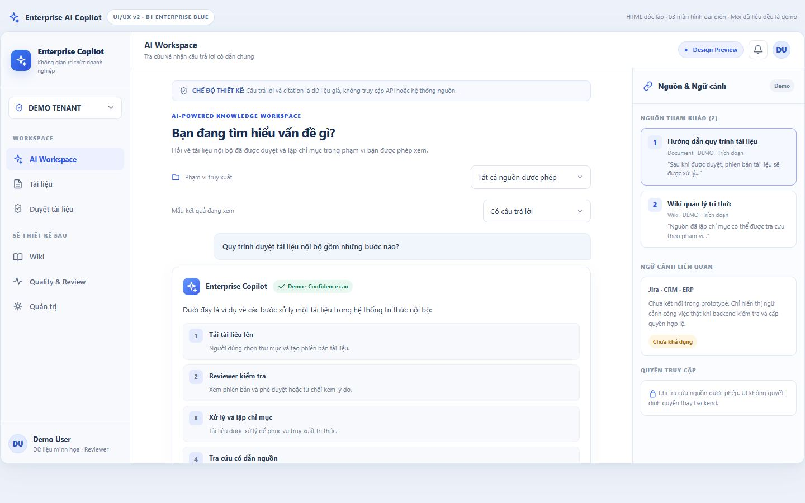 | 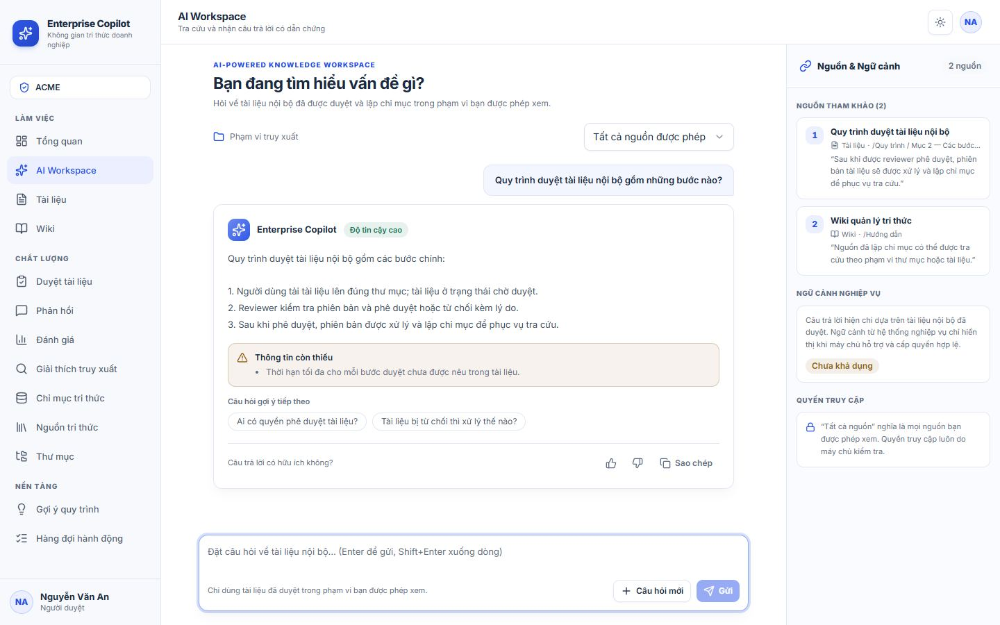 | 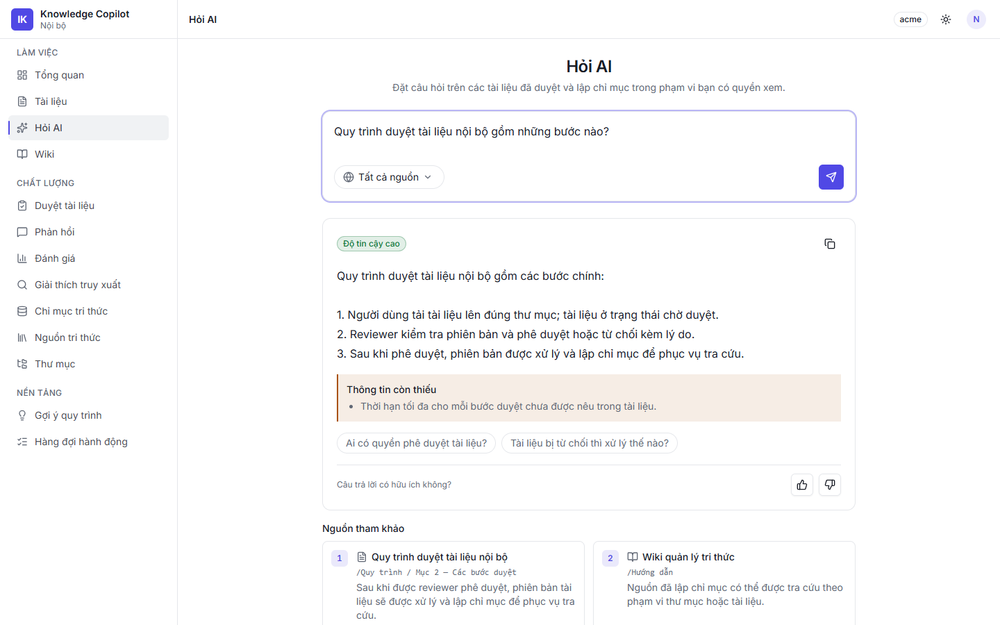 |
| UX-02 desktop | 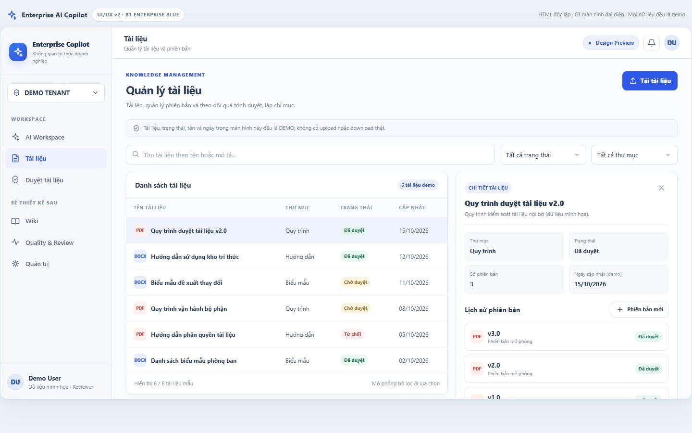 | 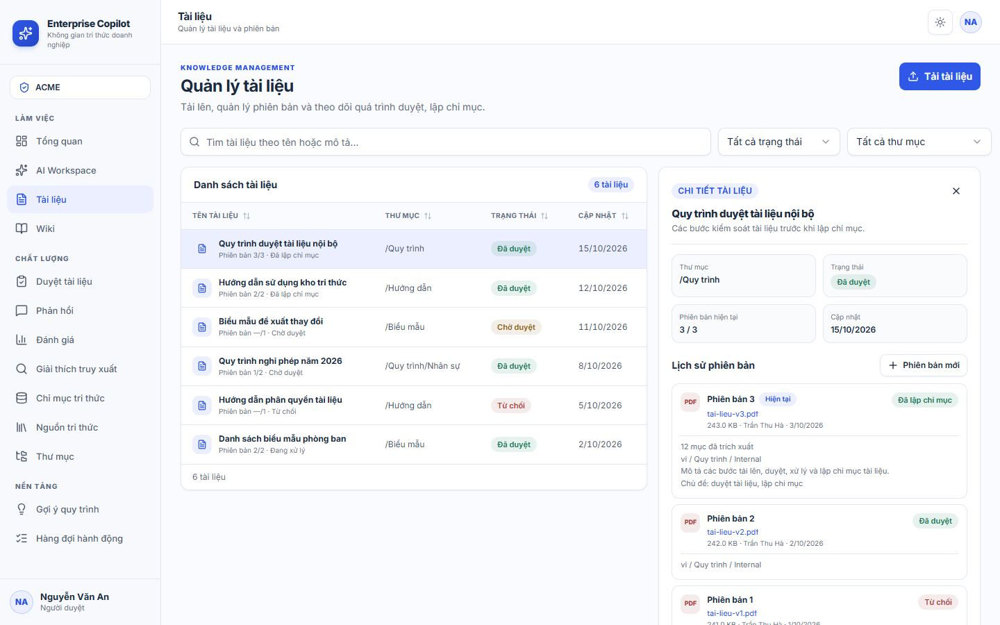 | 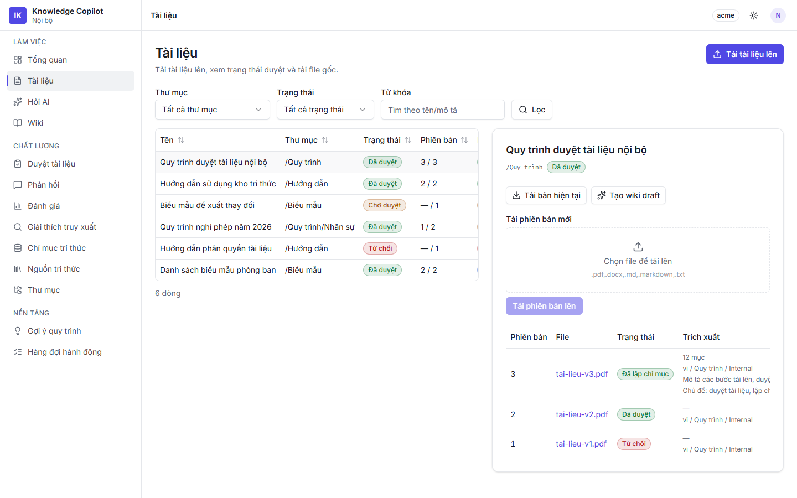 |
| UX-04 desktop | 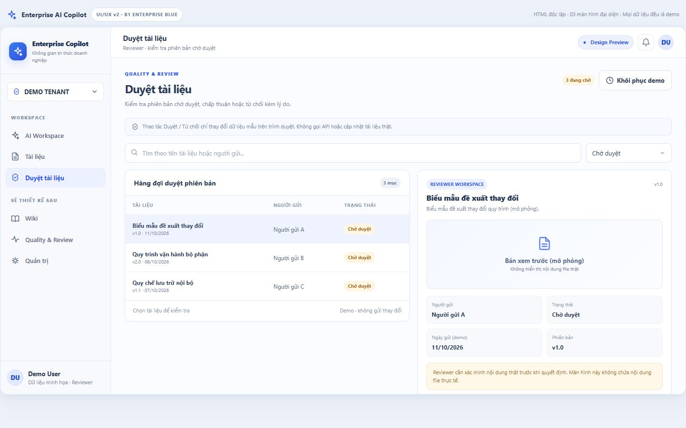 | 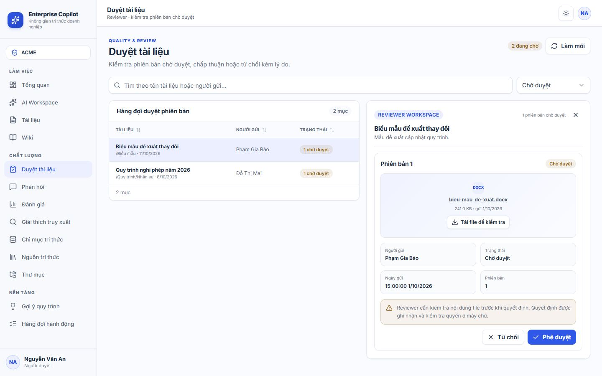 | 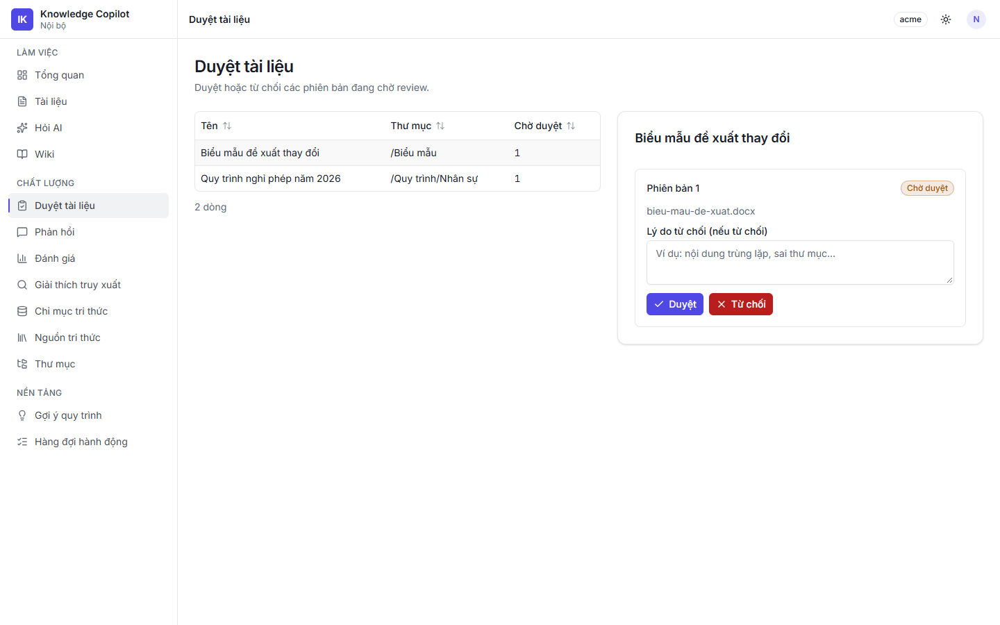 |
| UX-01 mobile | 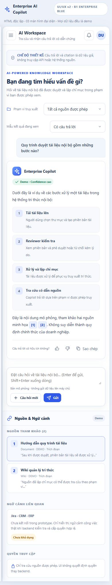 | 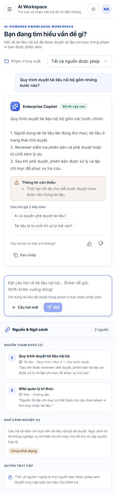 | — |
| UX-02 mobile | 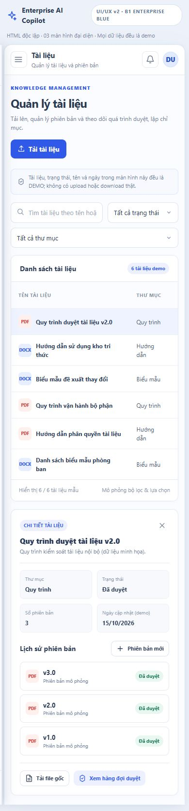 | 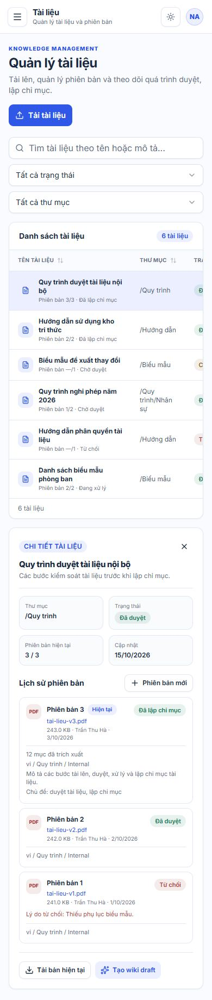 | — |
| UX-04 mobile | 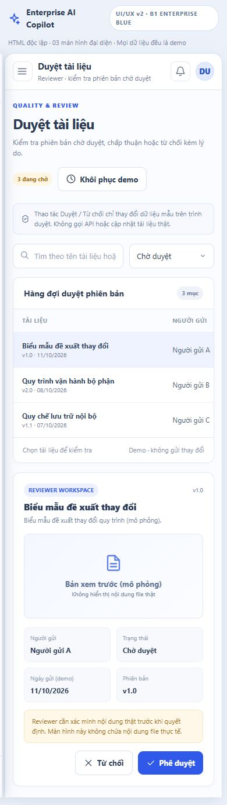 | 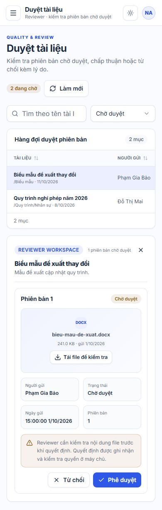 | — |

States and themes: [AI empty](ui-v2-i01/screenshots/vue-ai-empty-desktop-light.jpg) · [AI 403 denied](ui-v2-i01/screenshots/vue-ai-denied-desktop-light.jpg) · [AI dark](ui-v2-i01/screenshots/vue-ai-answer-desktop-dark.jpg) · [Upload dialog](ui-v2-i01/screenshots/vue-documents-upload-desktop-light.jpg) · [Documents empty](ui-v2-i01/screenshots/vue-documents-empty-desktop-light.jpg) · [Documents 403](ui-v2-i01/screenshots/vue-documents-error-desktop-light.jpg) · [Documents dark](ui-v2-i01/screenshots/vue-documents-desktop-dark.jpg) · [Reject dialog](ui-v2-i01/screenshots/vue-review-reject-desktop-light.jpg) · [Reject dialog mobile](ui-v2-i01/screenshots/vue-review-reject-mobile-light.jpg) · [Empty queue](ui-v2-i01/screenshots/vue-review-empty-desktop-light.jpg) · [Review dark](ui-v2-i01/screenshots/vue-review-desktop-dark.jpg) · [Mobile navigation drawer](ui-v2-i01/screenshots/vue-mobile-nav-mobile-light.jpg).

Other screens in the new shell (regression smoke, admin session): [Dashboard](ui-v2-i01/screenshots/vue-other_dashboard-desktop-light.jpg) · [Wiki](ui-v2-i01/screenshots/vue-other_wiki-desktop-light.jpg) · [Folders](ui-v2-i01/screenshots/vue-other_admin_folders-desktop-light.jpg) · [Retrieval explain](ui-v2-i01/screenshots/vue-other_retrieval-explain-desktop-light.jpg) — they render and keep their content; they pick up the B1 tokens/shell but were **not** redesigned.

Result: layout, proportions, typography scale, colours and component patterns of the three screens follow the B1 prototype; remaining differences are those listed in §3.

## 6. Limitations, risks and follow-up

1. **Not production-ready by appearance alone.** Verified against fixtures, not a running backend/database; an end-to-end pass on a test environment with real Reviewer/User/Admin accounts is still required.
2. **Global token change:** every other screen now uses the B1 blue primary, radius, badge, empty-state, table and dialog styles. Smoke-checked 4 other screens; the remaining 16 have not been visually reviewed and are not redesigned.
3. **Scroll container change:** the shell scrolls inside `<main>`. No page uses window scrolling APIs today, but future code should not assume `window` scroll.
4. **Backend observation (not changed):** `POST /documents/{id}/approve` and `/reject` do not check that the version is still `PendingReview`; the UI guard reduces but cannot eliminate double-decision races. Recommend a server-side state check in a separate, approved backend task.
5. **Accessibility:** contrast tuned to AA, labelled controls, keyboard row selection, reka focus-trapped dialogs/drawer, `aria-live` answer region, reduced-motion. A full screen-reader/keyboard audit (NVDA/VoiceOver) has not been performed.
6. **Copy consistency:** login page brand ("Knowledge Copilot") and the Feedback page text "từ trang Hỏi AI" still use old naming.
7. `index-standalone.html` defect on PR #11 (see §4).
8. Not done by design: conversation history, streaming, source deep links, connector context, notification centre, tenant switching.
